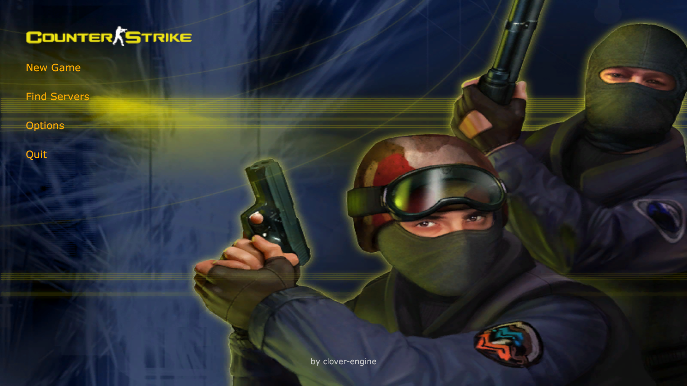
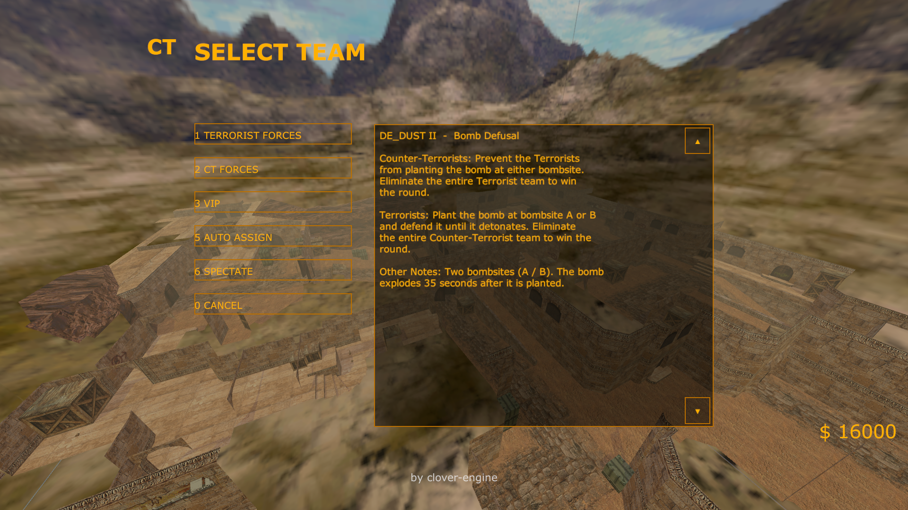
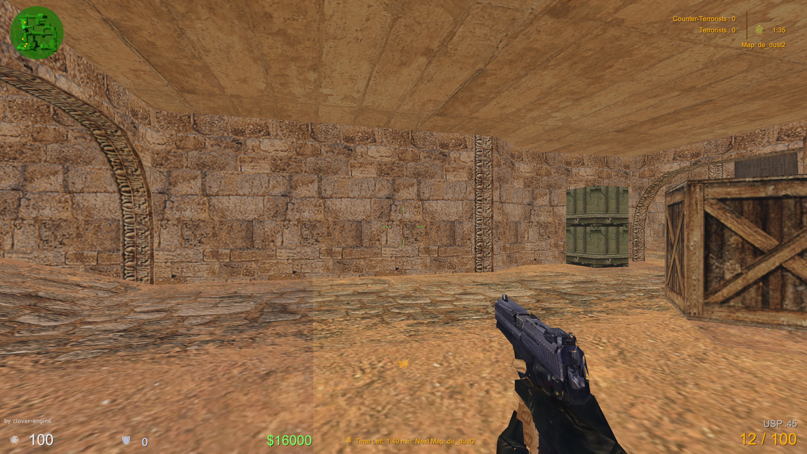
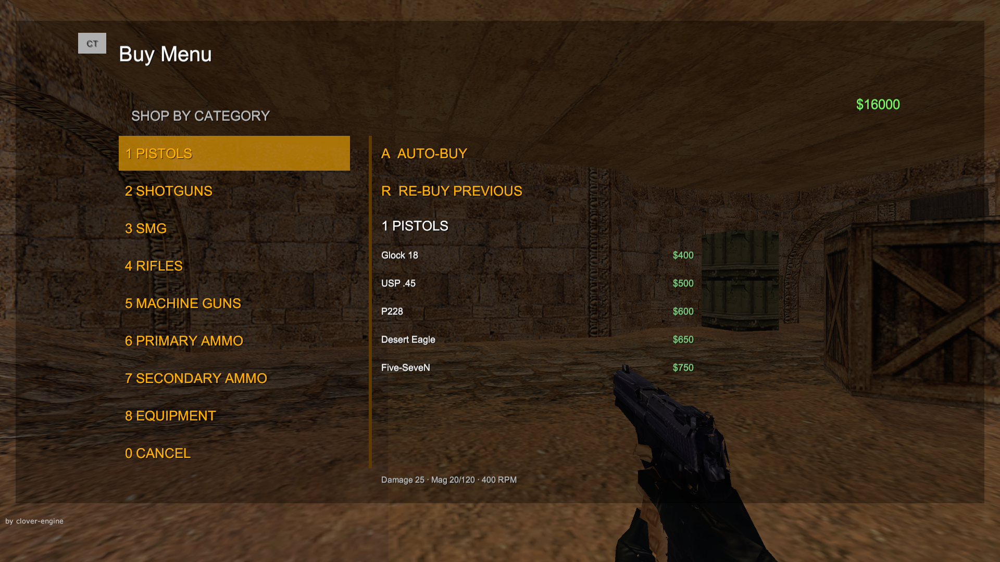

# Clover × Counter-Strike 1.6

用 [Clover 客户端引擎](https://github.com/qw576483/clover-client-unity-engine) **1:1 复刻《反恐精英 1.6》单机模式**的工程。

地图 **de_dust2**；复刻范围按六类系统：**A 启动菜单 · B HUD · C 玩法 · D 机器人 · E 地图 · F 资源**。

## 实机画面

| 主菜单 | 队伍选择 |
|---|---|
|  |  |

| 游戏内（de_dust2） | 购买菜单 |
|---|---|
|  |  |

> 截图取自本工程复刻版的**实际运行画面**（非原版素材）。

## 复刻范围

- **启动链路**：启动画面 → 主菜单（`New Game` / `Find Servers` / `Options` / `Quit`）→ 设局 → 读条 → 选阵营 → de_dust2
- **对战**：本地玩家 + 机器人（默认 4v4）、回合制（冻结 / 交战 / 结算）、购买菜单、C4 下包与拆包、经济与奖励、记分板
- **机器人**：三档难度（Easy / Normal / Hard）、寻路推进、无线电语音
- **地图与表现**：de_dust2 原版几何 / 贴图 / 天盒；HUD、字体与面板布局按原版像素还原
- **局域网**：`Find Servers` 走真实 UDP 寻服，`Host LAN Game` 让本机可被同网段发现

## 怎么玩

1. Unity **6000.x** 打开 `client/`；
2. 进 Play：主菜单 → 新游戏 → 选阵营 → 进 de_dust2；
3. 引擎包 `com.clover.unity-engine` 由 UPM 自动从 [clover-client-unity-engine](https://github.com/qw576483/clover-client-unity-engine) 拉取（首次打开联网克隆，之后走本地缓存）—— **需本机已装 Git 且在 `PATH` 里**。

## 工程结构

| 路径 | 内容 |
|---|---|
| `client/` | Unity 工程（复刻本体；`Library/` `Temp/` `Logs/` 等生成物不入库） |
| `策划/` | 复刻依据：单机参考规格、原版对照表（每行带出处）、外观差异清单、原版基线图、实机图（`images/`） |
| `tools/` | 判据与工具：编译检查、探针与量法脚本 |

## 声明

本项目**仅供技术交流与学习**，禁止用于任何商业用途。

## 相关仓库

| 仓库 | 说明 |
|---|---|
| [clover-client-unity-engine](https://github.com/qw576483/clover-client-unity-engine) | 客户端引擎（本工程的运行底座） |
| [clover-doc](https://github.com/qw576483/clover-doc) | 框架文档 |
| [clover-tools](https://github.com/qw576483/clover-tools) | 打表工具 |
